# Elegir y diagramar los 9 patrones del resumen
[← Índice Diseño de Sistemas](../INDICE.md)

> Unidad 3 · Peso 2 (entra en el 2º parcial, según el estudiante) · Fuente: *Resumen sobre
> patrones de diseño*, Ing. Germán Gaona (cátedra; lo pegó el estudiante el 2026-10-21, no
> está en `material/`). Los 9 patrones del resumen: Singleton, Factory Method, Abstract
> Factory, Composite, Facade, Proxy, State, Observer, Iterator. Los diagramas copian los del
> resumen. Las **señales en el enunciado**, los ejemplos y las trampas son *(tutor)*.
> Teoría completa (participantes, consecuencias) en [creacionales](patrones-creacionales.md),
> [estructurales](patrones-estructurales.md) y [de comportamiento](patrones-de-comportamiento.md).

## Preguntas de recuperación

- ¿Qué es un patrón según el resumen de la cátedra? :: Una descripción del problema y la esencia de su solución, que se puede reutilizar en casos distintos. [→ Las tres categorías](#Las%20tres%20categorías)
- ¿Cuáles son las tres categorías de patrones y qué abarca cada una? :: **De creación**: el proceso de instanciar objetos. **Estructurales**: la composición de objetos. **De comportamiento**: cómo se comunican y cooperan los objetos y cómo se reparten las responsabilidades. [→ Las tres categorías](#Las%20tres%20categorías)
- Clasificá los 9: Singleton, Factory Method, Abstract Factory, Composite, Facade, Proxy, State, Observer, Iterator :: Creación: Singleton, Factory Method, Abstract Factory. Estructurales: Composite, Facade, Proxy. Comportamiento: State, Observer, Iterator. [→ Las tres categorías](#Las%20tres%20categorías)
- Intención de Singleton :: Asegurar que una clase tenga **una única instancia** y dar un **punto de acceso global** a ella. [→ Singleton](#Singleton)
- Diagrama de Singleton :: Una sola clase `Singleton`: `-instance : Singleton` (estático), constructor **privado** `-Singleton()` y `+Instance() : Singleton` (estático), que la crea la primera vez y la devuelve. [→ Singleton](#Singleton)
- Intención de Factory Method :: Definir una interfaz para crear **un** objeto, pero dejar que **las subclases decidan qué clase instanciar**. [→ Factory Method](#Factory%20Method)
- Diagrama de Factory Method :: Dos jerarquías paralelas: `Product` ◁ `ConcreteProduct` y `Creator` (`+FactoryMethod()`, `+AnOperation()`) ◁ `ConcreteCreator` (`+FactoryMethod()`). `ConcreteCreator` - - > `ConcreteProduct` (punteada: lo crea). Notas: `product = FactoryMethod()` y `return new ConcreteProduct`. [→ Factory Method](#Factory%20Method)
- Intención de Abstract Factory :: Dar una interfaz para crear **familias de objetos relacionados** o dependientes sin especificar sus clases concretas. [→ Abstract Factory](#Abstract%20Factory)
- Diagrama de Abstract Factory :: `AbstractFactory` (`CreateProductA()`, `CreateProductB()`) ◁ `ConcreteFactory1` y `ConcreteFactory2`. Dos jerarquías de productos: `AbstractProductA` ◁ `ProductA1`, `ProductA2` y `AbstractProductB` ◁ `ProductB1`, `ProductB2`. `Client` → `AbstractFactory`, `AbstractProductA` y `AbstractProductB`. Punteadas: Factory1 → A1 y B1; Factory2 → A2 y B2. [→ Abstract Factory](#Abstract%20Factory)
- Intención de Composite :: Componer objetos en **estructuras de árbol** para representar jerarquías **parte-todo**, y que el cliente trate igual a los objetos individuales y a las composiciones. [→ Composite](#Composite)
- Diagrama de Composite :: `Client` → `Component` (`Operation()`, `Add()`, `Remove()`, `GetChild(i)`). `Component` ◁ `Leaf` (`Operation()`) y ◁ `Composite` (las cuatro). `Composite` ◇→ `Component` con rol `children`, multiplicidad 1 a *. Nota: `foreach child in children: child.Operation()`. [→ Composite](#Composite)
- Intención de Facade :: Dar una **interfaz unificada y de alto nivel** a un conjunto de interfaces de un subsistema, para que sea más fácil de usar. [→ Facade](#Facade)
- Diagrama de Facade :: Una clase `Facade` fuera de un paquete `Subsystem` y flechas de asociación desde `Facade` a varias clases de adentro del subsistema. El cliente sólo conoce la fachada. [→ Facade](#Facade)
- Intención de Proxy :: Dar un **representante o sustituto** de otro objeto para **controlar el acceso** a él. [→ Proxy](#Proxy)
- ¿Cuáles son los tres tipos de Proxy del resumen? :: **Remoto**: representa un objeto en otro espacio de direcciones. **Virtual**: crea objetos costosos por encargo (`ImageProxy`). **De protección**: controla los permisos de acceso al original. [→ Proxy](#Proxy)
- Diagrama de Proxy :: `Client` → `Subject` (`Request()`). `Subject` ◁ `RealSubject` y ◁ `Proxy`. `Proxy` → `RealSubject` con rol `realSubject`. Nota en `Proxy.Request()`: `realSubject.Request()`. [→ Proxy](#Proxy)
- Intención de State :: Permitir que un objeto **cambie su comportamiento cuando cambia su estado interno**. [→ State](#State)
- Diagrama de State :: `Context` (`Request()`) ◇→ `State` (`Handle()`) con rol `state`. `State` ◁ `ConcreteStateA` y `ConcreteStateB`. Nota en `Request()`: `state.Handle()`. [→ State](#State)
- Intención de Observer :: Definir una dependencia **uno a muchos**: cuando un objeto cambia de estado, se notifica y actualiza automáticamente a todos los que dependen de él. [→ Observer](#Observer)
- Diagrama de Observer :: `Subject` (`Attach(o)`, `Detach(o)`, `Notify()`) → `Observer` (`Update()`). `Subject` ◁ `ConcreteSubject` (`-subjectState`, `GetState()`). `Observer` ◁ `ConcreteObserver` (`-observerState`, `Update()`). `ConcreteObserver` → `ConcreteSubject` con rol `subject`. Notas: `foreach o in observers: o.Update()` · `return subjectState` · `observerState = subject.GetState()`. [→ Observer](#Observer)
- Intención de Iterator :: Acceder **secuencialmente** a los elementos de un contenedor **sin exponer su representación interna**. [→ Iterator](#Iterator)
- Diagrama de Iterator :: `Client` → `Aggregate` (`CreateIterator()`) y → `Iterator` (`First()`, `Next()`, `IsDone()`, `CurrentItem()`). `Aggregate` ◁ `ConcreteAggregate`; `Iterator` ◁ `ConcreteIterator`. `ConcreteAggregate` - - > `ConcreteIterator` (lo crea) y `ConcreteIterator` → `ConcreteAggregate`. Nota: `return new ConcreteIterator(this)`. [→ Iterator](#Iterator)
- En Composite, ¿qué es el Component? ¿Es un nivel del árbol? :: La **clase abstracta común** a hojas y compuestos, que declara la operación (`costoSalarial()`) y la gestión de hijos. No es un nivel: los niveles intermedios (Gerencia, Sistemas) son **instancias del Composite** (`Area`). [→ Ejemplo Composite](#Ejemplo%20Composite:%20organigrama)
- En Observer, ¿cómo reconocés al Subject y a los Observers en un enunciado? :: El **Subject** es lo que **cambia de estado** (la agenda que se cancela). Los **Observers** son **todos los que reaccionan** (mail, tablero, auditoría), no sólo las personas a las que se avisa. [→ Ejemplo Observer](#Ejemplo%20Observer:%20agenda%20médica)
- En State, ¿quién es el Context y qué hace? :: El objeto que **"puede estar"** en distintos estados (la máquina expendedora). Guarda su estado actual y le **delega** cada operación: `estado.seleccionarProducto(this)`. [→ Ejemplo State](#Ejemplo%20State:%20máquina%20expendedora)
- En State, ¿quién cambia de un estado a otro? :: Los **estados concretos**: al terminar su acción llaman `contexto.setEstado(new OtroEstado())`. [→ Ejemplo State](#Ejemplo%20State:%20máquina%20expendedora)
- ¿Qué diferencia a Factory Method de Abstract Factory? :: Factory Method crea **un** producto y usa **herencia**: la subclase del creador decide. Abstract Factory crea una **familia** de productos que van juntos y usa **composición**: el cliente recibe un objeto fábrica. [→ Pares que se confunden](#Pares%20que%20se%20confunden)
- ¿Qué diferencia a Facade de Proxy? :: Facade da una interfaz **nueva y más simple** para **muchas** clases. Proxy tiene **la misma interfaz** que **un** objeto y se pone delante para controlar el acceso. [→ Pares que se confunden](#Pares%20que%20se%20confunden)
- ¿Qué diferencia a State de Observer? :: En State el objeto cambia **su propio** comportamiento según su estado. En Observer el objeto **avisa a otros** que cambió, y son ellos los que reaccionan. [→ Pares que se confunden](#Pares%20que%20se%20confunden)

## Cuestionario

1. Un sistema de logística crea el transporte de cada envío. `LogisticaTerrestre` debe usar `Camion` y `LogisticaMaritima` debe usar `Barco`, pero el método `planificarEntrega()` es el mismo en las dos. ¿Qué patrón conviene?
   - [x] Factory Method
   - [ ] Abstract Factory
   - [ ] Singleton
   - [ ] State
   > Un solo producto (`Transporte`) y son las **subclases** del creador las que deciden cuál instanciar: `crearTransporte()` es el método de fábrica que llama `planificarEntrega()`. [→ Factory Method](#Factory%20Method)
2. Una app de escritorio tiene tema claro y tema oscuro. Cada tema tiene sus botones, menús y ventanas, y nunca se debe mezclar un botón oscuro con un menú claro. ¿Qué patrón conviene?
   - [x] Abstract Factory
   - [ ] Factory Method
   - [ ] Composite
   - [ ] Facade
   > **Familias** de productos que deben usarse juntos: una fábrica concreta por tema crea todos sus widgets. Si fuera un solo widget, sería Factory Method. [→ Abstract Factory](#Abstract%20Factory)
3. El sistema necesita un único objeto de configuración que lean todos los módulos, y no debe poder crearse un segundo. ¿Qué patrón conviene?
   - [x] Singleton
   - [ ] Facade
   - [ ] Proxy
   - [ ] Abstract Factory
   > "Una sola instancia" + "acceso desde todos lados" = Singleton: constructor privado y `Instance()` estático. [→ Singleton](#Singleton)
4. En una tienda, un combo puede contener productos sueltos y también otros combos. Hay que calcular el precio de cualquier combo sin que el cliente distinga si tiene un producto o un combo. ¿Qué patrón conviene?
   - [x] Composite
   - [ ] Iterator
   - [ ] Facade
   - [ ] Observer
   > Árbol parte-todo y tratamiento **uniforme**: `Producto` es la hoja, `Combo` el compuesto, y `precio()` del combo suma el `precio()` de cada hijo. [→ Composite](#Composite)
5. Para confirmar una compra hay que llamar al módulo de stock, al de pagos, al de facturación y al de envíos, en ese orden. La pantalla de compra hoy conoce los cuatro módulos. ¿Qué patrón conviene?
   - [x] Facade
   - [ ] Proxy
   - [ ] Composite
   - [ ] Observer
   > Interfaz simple (`confirmarCompra()`) para un subsistema complejo: la pantalla sólo conoce la fachada y baja el acoplamiento. Proxy no aplica: no hay **un** objeto al que controlar el acceso. [→ Facade](#Facade)
6. Un visor de documentos muestra miniaturas de imágenes muy pesadas. Las imágenes reales sólo deben cargarse cuando el usuario abre una. ¿Qué patrón conviene?
   - [x] Proxy (virtual)
   - [ ] Proxy (de protección)
   - [ ] Facade
   - [ ] Singleton
   > Crear un objeto costoso **por encargo** es el Proxy virtual (`ImageProxy`, el ejemplo del resumen). El de protección controla permisos. [→ Proxy](#Proxy)
7. Antes de que cualquier usuario consulte los sueldos, el sistema tiene que verificar que tenga rol de RR. HH., sin tocar la clase `ServicioSueldos`. ¿Qué patrón conviene?
   - [x] Proxy (de protección)
   - [ ] Proxy (remoto)
   - [ ] Facade
   - [ ] State
   > Un sustituto con la misma interfaz que controla el **acceso** (permisos) al objeto real y, si corresponde, le delega la llamada. [→ Proxy](#Proxy)
8. Un pedido pasa por Pendiente, Pagado, Enviado y Entregado. `cancelar()` hace algo distinto en cada uno, y el código está lleno de `if (estado == ...)`. ¿Qué patrón conviene?
   - [x] State
   - [ ] Observer
   - [ ] Factory Method
   - [ ] Iterator
   > El comportamiento **del propio pedido** cambia con su estado interno: una clase por estado con `cancelar()` y el pedido (Context) delega en su estado actual. [→ State](#State)
9. Cuando cambia el precio de un producto, hay que avisar a la vista del catálogo, al módulo de estadísticas y a los clientes que lo marcaron como favorito. La cantidad de interesados varía. ¿Qué patrón conviene?
   - [x] Observer
   - [ ] State
   - [ ] Facade
   - [ ] Composite
   > Uno a muchos, sin saber cuántos ni quiénes: el producto (Subject) mantiene la lista de observadores y les manda `Update()` al cambiar. [→ Observer](#Observer)
10. Una colección de alumnos se guarda a veces como lista y a veces como árbol. Las pantallas tienen que recorrerla siempre igual y sin saber cómo está guardada. ¿Qué patrón conviene?
    - [x] Iterator
    - [ ] Composite
    - [ ] Facade
    - [ ] Proxy
    > Recorrer sin exponer la representación interna, con una interfaz uniforme para distintos contenedores (iteración polimórfica). Composite **arma** el árbol; Iterator lo **recorre**. [→ Iterator](#Iterator)
11. En el diagrama de Proxy, ¿qué relación hay entre `Proxy` y `RealSubject`?
    - [x] `Proxy` hereda de `Subject` como `RealSubject` y además tiene una asociación con `RealSubject`
    - [ ] `Proxy` hereda de `RealSubject`
    - [ ] `RealSubject` tiene una referencia al `Proxy`
    - [ ] `Proxy` y `RealSubject` no se relacionan; sólo los conoce el cliente
    > Los dos implementan `Subject`, así el cliente no distingue cuál tiene. El proxy guarda `realSubject` y le delega `Request()`. [→ Proxy](#Proxy)
12. En el diagrama de Composite, ¿qué clase tiene el rombo de agregación y hacia dónde apunta?
    - [x] `Composite`, hacia `Component` (rol `children`, multiplicidad *)
    - [ ] `Component`, hacia `Leaf`
    - [ ] `Composite`, hacia `Leaf`
    - [ ] `Client`, hacia `Component`
    > El compuesto contiene **componentes** (hojas u otros compuestos), no sólo hojas: por eso la agregación va de `Composite` a `Component`, y eso habilita la recursión. [→ Composite](#Composite)
13. En el diagrama de State, ¿dónde está la nota `state.Handle()`?
    - [x] En `Context.Request()`
    - [ ] En `ConcreteStateA.Handle()`
    - [ ] En `State.Handle()`
    - [ ] En el cliente
    > El contexto **delega** en el estado actual: `Request()` llama a `state.Handle()`. [→ State](#State)
14. En el diagrama de Observer, ¿qué hace `ConcreteObserver.Update()`?
    - [x] `observerState = subject.GetState()`: le pide el estado al sujeto concreto
    - [ ] Recorre la lista de observadores
    - [ ] Llama a `Notify()` del sujeto
    - [ ] Devuelve `subjectState`
    > `Notify()` (en `Subject`) recorre los observadores; `GetState()` devuelve `subjectState`; `Update()` sincroniza el observador consultando al sujeto, por eso existe la flecha `subject`. [→ Observer](#Observer)
15. Un sistema debe poder trabajar con SQL Server u Oracle. Para cada motor hace falta una conexión, un comando y un lector compatibles entre sí. ¿Qué patrón conviene?
    - [x] Abstract Factory
    - [ ] Factory Method
    - [ ] Facade
    - [ ] Proxy (remoto)
    > Tres productos que tienen que ser **del mismo motor**: familia → `FabricaSQLServer` y `FabricaOracle`, cada una con `crearConexion()`, `crearComando()` y `crearLector()`. [→ Abstract Factory](#Abstract%20Factory)

## Contenido

### Las tres categorías

Un **patrón** es una descripción del problema y la esencia de su solución, que se puede
reutilizar en casos distintos. El resumen los agrupa en tres categorías:

| Categoría | Qué abarca | Los del resumen |
|---|---|---|
| De creación | El proceso de instanciar objetos | Singleton, Factory Method, Abstract Factory |
| Estructurales | La composición de objetos | Composite, Facade, Proxy |
| De comportamiento | Cómo se comunican y cooperan los objetos y cómo se reparten las responsabilidades | State, Observer, Iterator |

### Cómo elegir: señales en el enunciado

*(tutor)* Buscá la frase del enunciado que describe el problema, no la solución:

| Si el enunciado dice… | Patrón |
|---|---|
| "una sola instancia", "único", "acceso global", configuración, *logger*, pool de conexiones | **Singleton** |
| "la clase no sabe qué objeto va a crear", "cada subclase crea su propio…", **un** tipo de producto | **Factory Method** |
| "familias", "temas", "no mezclar", "compatibles entre sí", varios proveedores o plataformas | **Abstract Factory** |
| árbol, "contiene", "parte-todo", carpetas y archivos, menú con submenús, "tratar igual al individual y al grupo" | **Composite** |
| "simplificar", "punto de entrada único", subsistema complejo, muchas dependencias, capas | **Facade** |
| "controlar el acceso", permisos, "cargar cuando se necesite", objeto costoso, objeto en otro servidor | **Proxy** |
| "según el estado se comporta distinto", muchos `if`/`switch` sobre el estado, transiciones | **State** |
| "avisar / notificar a todos los que…", "suscribirse", uno a muchos, "no sabemos cuántos" | **Observer** |
| "recorrer sin exponer cómo está guardado", varios recorridos, recorrer igual distintas colecciones | **Iterator** |

### Cómo dibujar cualquiera

*(tutor)* Todos los diagramas del resumen siguen el mismo esqueleto:

1. **Arriba, la abstracción** (clase abstracta o interfaz, nombre en *cursiva*) con los métodos que importan.
2. **Abajo, los concretos**, unidos con **herencia**: línea llena con triángulo hueco apuntando a la abstracción.
3. **El cliente apunta a la abstracción**, nunca al concreto: asociación, línea llena con flecha abierta.
4. **Lo propio del patrón**: la asociación o agregación que lo distingue (`realSubject`, `state`, `children`, `subject`) y las flechas **punteadas** de "crea" (dependencia).
5. **Notas con código** (rectángulo con la esquina doblada) en los métodos clave: es lo que demuestra que entendiste cómo funciona.

| Relación | Cómo se dibuja | Dónde aparece |
|---|---|---|
| Herencia | Línea llena, triángulo hueco hacia el padre | En todos menos Singleton y Facade |
| Asociación | Línea llena, flecha abierta | Cliente → abstracción, `Proxy → RealSubject`, `Observer → Subject` |
| Agregación | Rombo hueco del lado del **todo** | `Composite ◇→ Component`, `Context ◇→ State` |
| Dependencia ("crea") | Línea punteada, flecha abierta | Fábricas → productos, `ConcreteAggregate → ConcreteIterator` |

### Singleton

- **Intención**: asegurar que una clase tenga **una única instancia** y dar un **punto de acceso global** a ella.
- **Aplicabilidad**: debe haber una sola instancia, accesible a los clientes desde un punto conocido · la única instancia debe poder extenderse por subclases y los clientes deben poder usar la versión extendida sin cambiar su código.
- **Para dibujarlo**: una sola clase. Atributo estático `-instance` (subrayado en UML), constructor **privado** (el `-` es la clave: nadie más puede hacer `new`) y método estático `+Instance()`.

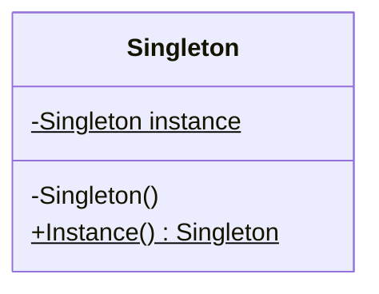

### Factory Method

- **Intención**: definir una interfaz para crear un objeto, pero dejar que **las subclases decidan qué clase instanciar**. La clase delega en sus subclases la creación.
- **Aplicabilidad**: una clase no puede prever la clase de los objetos que tiene que crear · quiere que sus subclases decidan qué crean · delega en una de varias clases auxiliares y se quiere localizar en cuál.
- **Para dibujarlo**: dos jerarquías **paralelas** (productos a la izquierda, creadores a la derecha) y una punteada de `ConcreteCreator` a `ConcreteProduct`. Notas: en `AnOperation()`, `product = FactoryMethod()`; en `ConcreteCreator.FactoryMethod()`, `return new ConcreteProduct`.

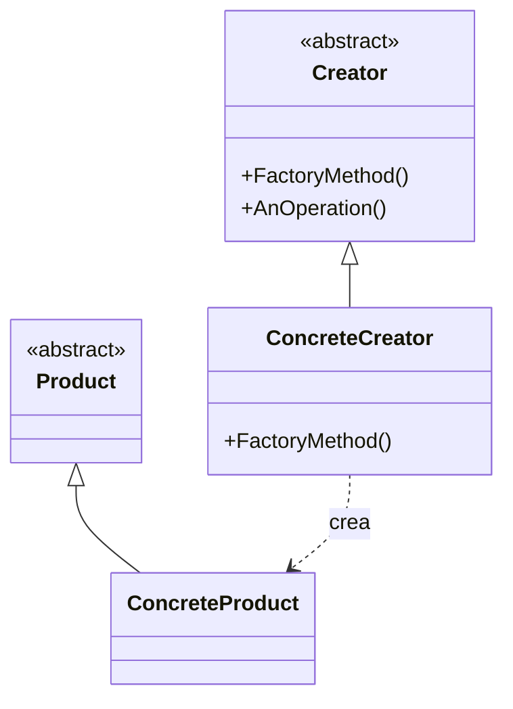

### Abstract Factory

- **Intención**: proporcionar una interfaz para crear **familias de objetos relacionados** o que dependen entre sí, sin especificar sus clases concretas.
- **Aplicabilidad**: el sistema debe ser independiente de cómo se crean, componen y representan sus productos · se configura con una familia entre varias · los productos de una familia se diseñaron para usarse juntos y hay que hacer cumplir esa restricción · se quiere dar una biblioteca de productos revelando sólo sus interfaces.
- **Para dibujarlo**: una fábrica abstracta con **un método `Create` por producto**, una fábrica concreta **por familia** y una jerarquía **por producto**. El cliente conoce sólo las abstractas (tres flechas). Cada fábrica concreta tiene punteadas a los productos de **su** familia (el número del nombre lo delata: Factory1 → A1, B1).

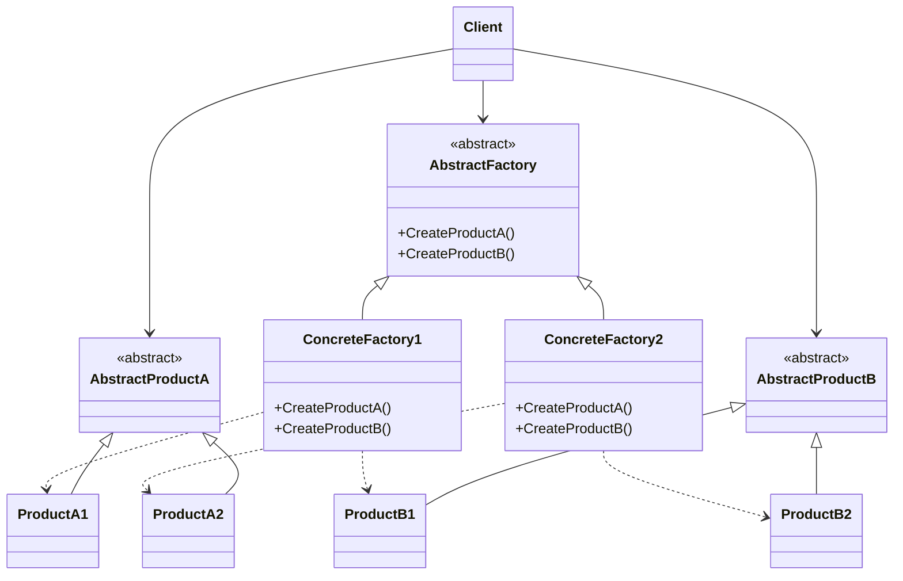

### Composite

- **Intención**: componer objetos en **estructuras de árbol** para representar jerarquías **parte-todo**.
- **Aplicabilidad**: se quieren representar jerarquías todo/parte · se quiere que los clientes ignoren la diferencia entre composiciones y objetos individuales y los traten de manera uniforme.
- **Para dibujarlo**: `Component` abstracto con `Operation()` y las de gestión de hijos (`Add`, `Remove`, `GetChild`). `Leaf` sólo redefine `Operation()`. La clave es la **agregación de `Composite` a `Component`** (no a `Leaf`), rol `children`, 1 a *: un compuesto puede contener otros compuestos. Nota en `Composite.Operation()`: `foreach child in children: child.Operation()`.

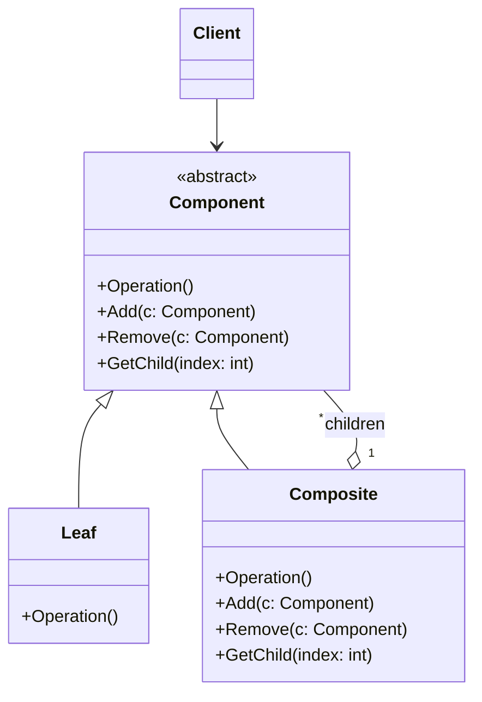

### Facade

- **Intención**: proporcionar una **interfaz unificada** para un conjunto de interfaces de un subsistema. Define una interfaz de **alto nivel** que lo hace más fácil de usar.
- **Aplicabilidad**: dar una interfaz simple a un subsistema complejo (sólo los clientes que necesitan más personalización van más allá de la fachada) · hay muchas dependencias entre los clientes y las clases del subsistema: la fachada los **desacopla** (mejora acoplamiento y portabilidad) · se quiere **dividir en capas**: la fachada es el punto de entrada a cada subsistema.
- **Para dibujarlo**: una clase `Facade` arriba, un paquete `Subsystem` debajo con varias clases sueltas, y flechas de la fachada a ellas. **No hay herencia.** Es el único del resumen sin jerarquía.
- Se conecta con el 2º parcial: en la [arquitectura en capas](estilos-arquitectonicos.md), la fachada es la entrada a cada capa; en GRASP es una forma de [Indirección](patrones-grasp.md).

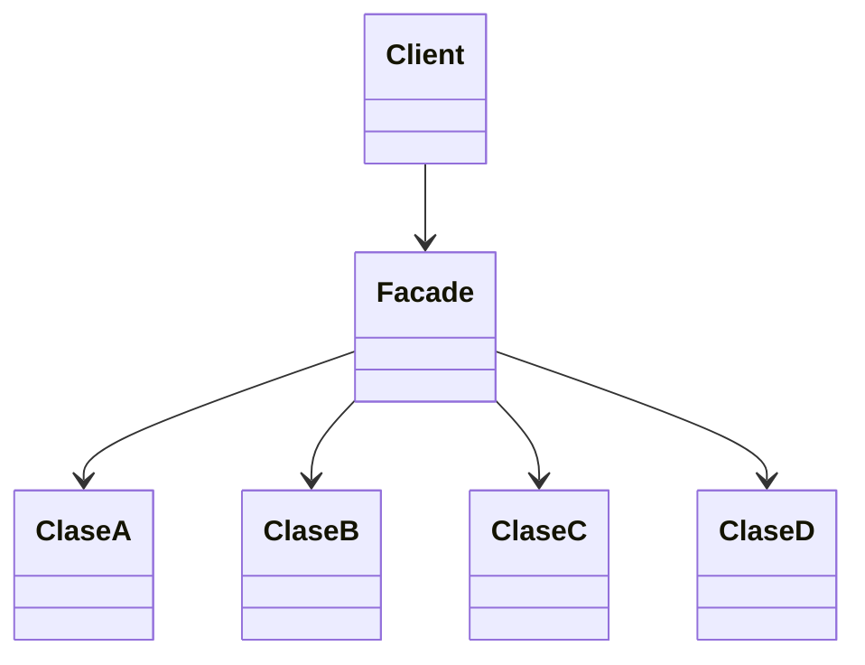

### Proxy

- **Intención**: proporcionar un **representante o sustituto** de otro objeto para **controlar el acceso** a él.
- **Aplicabilidad**: se necesita una referencia a un objeto más flexible o sofisticada que un puntero.
  - **Remoto**: representa a un objeto que está en otro espacio de direcciones.
  - **Virtual**: crea objetos costosos por encargo (ej.: `ImageProxy`).
  - **De protección**: controla el acceso al objeto original (permisos).
- **Para dibujarlo**: `Proxy` y `RealSubject` **hermanos** bajo `Subject` (así el cliente no nota la diferencia), y una asociación `Proxy → RealSubject` con rol `realSubject`. Nota en `Proxy.Request()`: `realSubject.Request()`.

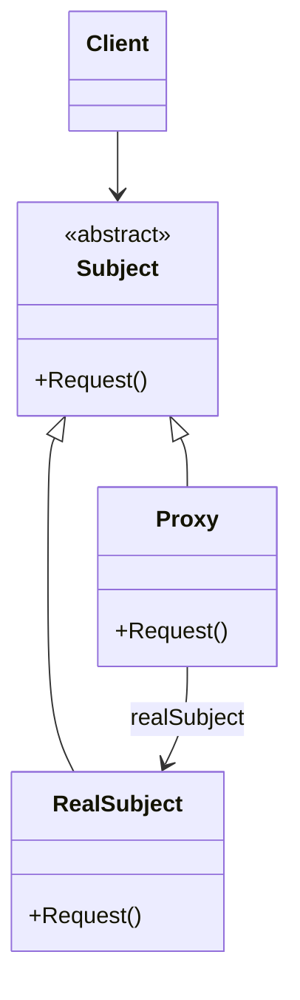

### State

- **Intención**: permitir que un objeto **modifique su comportamiento cada vez que cambia su estado interno**.
- **Para dibujarlo**: `Context` con **agregación** (rombo de su lado) a `State`, rol `state`. `State` abstracto con `Handle()` y un `ConcreteState` por estado. Nota en `Context.Request()`: `state.Handle()`. *(tutor)* Para aplicarlo: cada `if (estado == X)` pasa a ser una clase `EstadoX`.

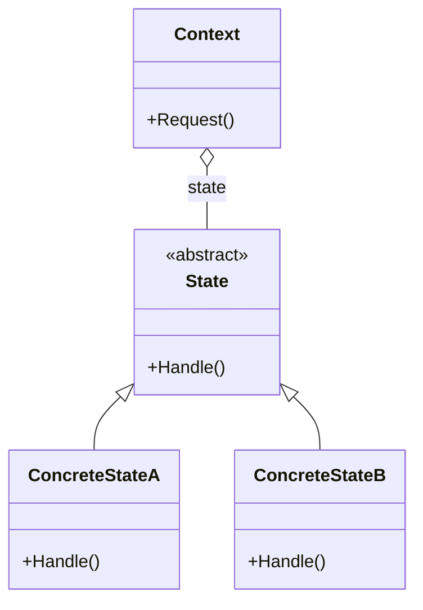

### Observer

- **Intención**: definir una dependencia **uno a muchos** entre objetos, de forma que cuando uno cambie de estado se notifique y actualicen automáticamente todos los que dependen de él.
- **Aplicabilidad**: una abstracción tiene dos aspectos y uno depende del otro · un cambio en un objeto requiere cambiar otros y no se sabe cuántos · un objeto debe notificar a otros sin suponer quiénes son (no se quiere acoplamiento fuerte).
- **Para dibujarlo**: el diagrama más cargado. Dos jerarquías (`Subject` ◁ `ConcreteSubject`, `Observer` ◁ `ConcreteObserver`) y **dos asociaciones cruzadas**: arriba `Subject → Observer` (rol `observer`, la lista) y abajo `ConcreteObserver → ConcreteSubject` (rol `subject`). Tres notas:
  - `Subject.Notify()`: `foreach o in observers: o.Update()`
  - `ConcreteSubject.GetState()`: `return subjectState`
  - `ConcreteObserver.Update()`: `observerState = subject.GetState()`

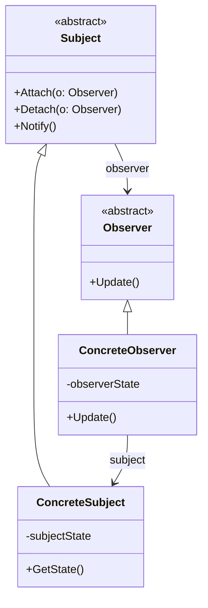

### Iterator

- **Intención**: proporcionar un medio de acceder a los elementos de un contenedor **secuencialmente** sin exponer su representación interna.
- **Aplicabilidad**: acceder al contenido de un contenedor sin exponer su representación · permitir **varios recorridos** sobre contenedores · dar una interfaz uniforme para recorrer distintos tipos de contenedores (**iteración polimórfica**).
- **Para dibujarlo**: el cliente en el medio, apuntando a `Aggregate` (izquierda) y a `Iterator` (derecha). Abajo, `ConcreteAggregate` con punteada a `ConcreteIterator` (lo crea) y `ConcreteIterator` con asociación de vuelta (lo recorre). Nota en `CreateIterator()`: `return new ConcreteIterator(this)`. Los cuatro métodos: `First`, `Next`, `IsDone`, `CurrentItem`.

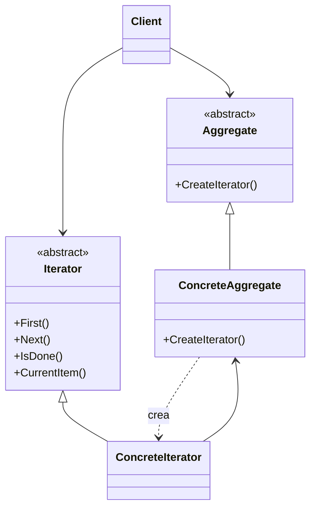

### Ejemplos resueltos

*(tutor)* Los nueve casos de la sesión del 2026-10-21, diagramados con clases concretas. En
cada uno: la tabla de roles (qué clase cumple cada rol del diagrama genérico), el diagrama y
el código de los métodos clave (lo que en el resumen va en las notas). Al final, el ejemplo
equivalente de [refactoring.guru](https://refactoring.guru/es/design-patterns) para comparar.
En Obsidian, `<<interface>>` y `<<abstract>>` se ven como estereotipos; a mano, el nombre va en *cursiva*.

### Ejemplo Singleton: configuración del sistema

| Rol | Clase |
|---|---|
| Singleton | `Configuracion` |
| Cliente | `PantallaLogin` (y cualquier otra clase) |

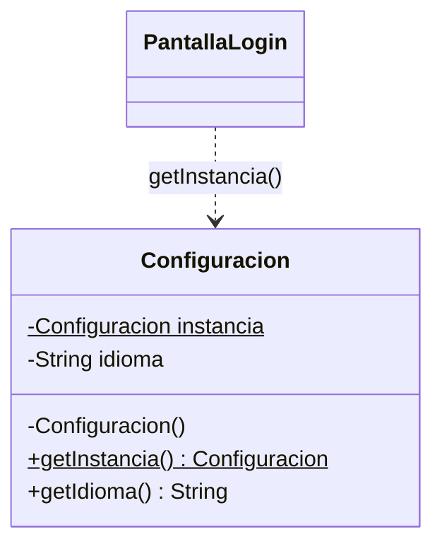

- `getInstancia()`: `if (instancia == null) instancia = new Configuracion(); return instancia;`
- Desde afuera: `Configuracion.getInstancia().getIdioma()`. `new Configuracion()` **no compila**: el constructor es privado.
- refactoring.guru: la clase `Database`, una sola conexión compartida.

### Ejemplo Factory Method: reportes con exportador

| Rol | Clase |
|---|---|
| Creator | `Reporte` |
| ConcreteCreator | `ReportePDF`, `ReporteExcel` |
| Product | `Exportador` |
| ConcreteProduct | `ExportadorPDF`, `ExportadorExcel` |

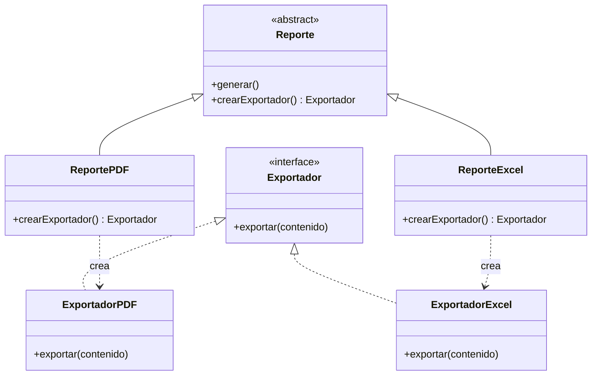

- `Reporte.generar()` (la `AnOperation`): `exp = crearExportador(); exp.exportar(encabezado + cuerpo + pie);`. **No sabe** qué exportador recibe.
- `ReportePDF.crearExportador()` (el método de fábrica): `return new ExportadorPDF();`
- Agregar Word = `ReporteWord` + `ExportadorWord`. `generar()` no se toca.
- refactoring.guru: `Logistica` con `LogisticaTerrestre` (crea `Camion`) y `LogisticaMaritima` (crea `Barco`).

### Ejemplo Abstract Factory: niveles de un videojuego

| Rol | Clase |
|---|---|
| AbstractFactory | `FabricaNivel` |
| ConcreteFactory | `FabricaMedieval`, `FabricaFuturista` |
| AbstractProduct | `Enemigo`, `Arma`, `Escenario` |
| ConcreteProduct | `Caballero`, `Espada`, `Castillo` · `Robot`, `RifleLaser`, `EstacionEspacial` |
| Client | `Juego` |

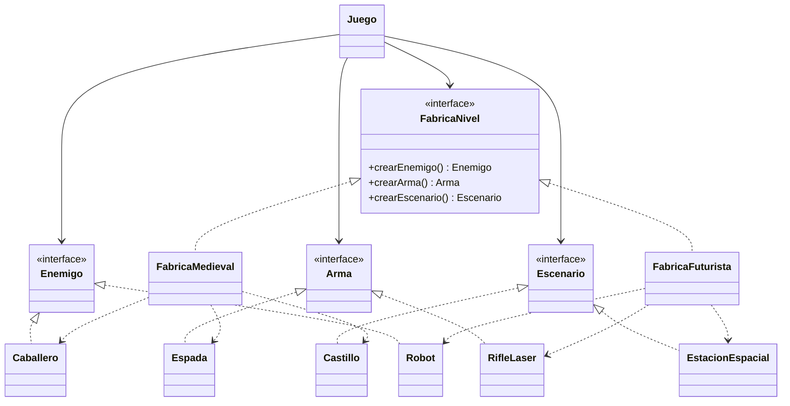

- `Juego` recibe la fábrica una vez: `new Juego(new FabricaMedieval())`. Después sólo llama `fabrica.crearEnemigo()`, `fabrica.crearArma()`… y **no puede** mezclar un `Caballero` con un `RifleLaser`, porque cada fábrica sólo crea los de su familia.
- Cuenta de cajas: 1 fábrica abstracta + **N fábricas concretas (una por familia)** + **M jerarquías (una por producto)** con N productos cada una.
- Agregar una familia (nivel "Pirata") es fácil: una fábrica y tres productos. Agregar un **producto** nuevo (`Mascota`) es caro: cambia `FabricaNivel` y todas las fábricas.
- refactoring.guru: muebles `Silla`, `Sofa`, `Mesita` en estilos `Moderno` y `Victoriano`.

### Ejemplo Composite: organigrama

| Rol | Clase |
|---|---|
| Component | `UnidadOrganizacional`: la **abstracción común**, no un nivel del árbol |
| Leaf | `Empleado` |
| Composite | `Area`: Gerencia, Sistemas y Desarrollo son **instancias** de esta clase |
| Client | `SistemaRRHH` |

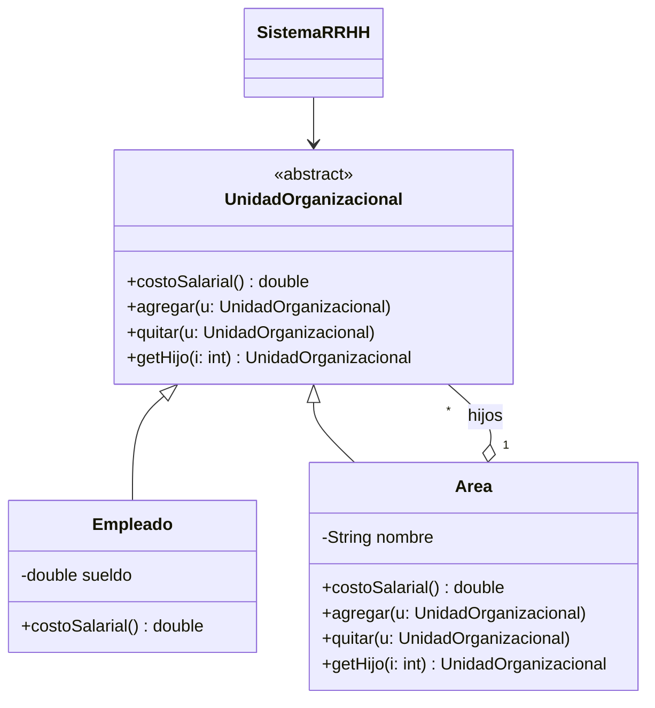

El árbol de **objetos** en ejecución (no es el diagrama de clases): tres niveles de áreas, una sola clase `Area`.

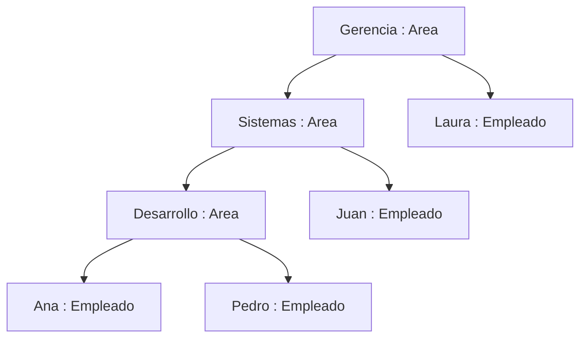

- `Empleado.costoSalarial()`: `return sueldo;`
- `Area.costoSalarial()`: `total = 0; foreach hijo in hijos: total += hijo.costoSalarial(); return total;`. La recursión sale sola: si el hijo es otra `Area`, suma a sus propios hijos.
- `gerencia.costoSalarial()` y `ana.costoSalarial()` son **la misma llamada**: eso es "tratar uniforme".
- refactoring.guru: un pedido con `Producto`s y `Caja`s que contienen productos u otras cajas; el precio total se calcula igual.

### Ejemplo Facade: inscripción de alumnos

| Rol | Clase |
|---|---|
| Facade | `FachadaInscripcion` |
| Clases del subsistema | `ValidadorDNI`, `RepositorioAlumnos`, `GeneradorLegajo`, `ServicioMail`, `ServicioAFIP` |
| Cliente | `PantallaInscripcion` |

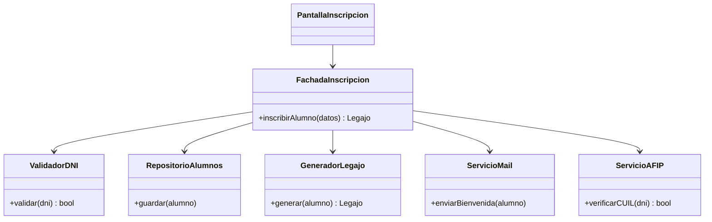

- `inscribirAlumno(datos)`: `validador.validar(dni); afip.verificarCUIL(dni); repo.guardar(alumno); legajo = generador.generar(alumno); mail.enviarBienvenida(alumno); return legajo;`
- **Antes**: la pantalla tenía 5 flechas. **Después**: 1. Si cambia `ServicioAFIP`, se toca la fachada y no la pantalla.
- Sin herencia. Las clases del subsistema **no conocen** a la fachada (las flechas van de la fachada hacia ellas).
- refactoring.guru: `VideoConverter`, que esconde una biblioteca compleja de conversión de video detrás de `convert(archivo, formato)`.

### Ejemplo Proxy: cuenta bancaria remota

| Rol | Clase |
|---|---|
| Subject | `Cuenta` |
| RealSubject | `CuentaReal` (vive en el servidor del banco) |
| Proxy | `CuentaProxy` (vive en la app) |
| Client | `AppBancaria` |

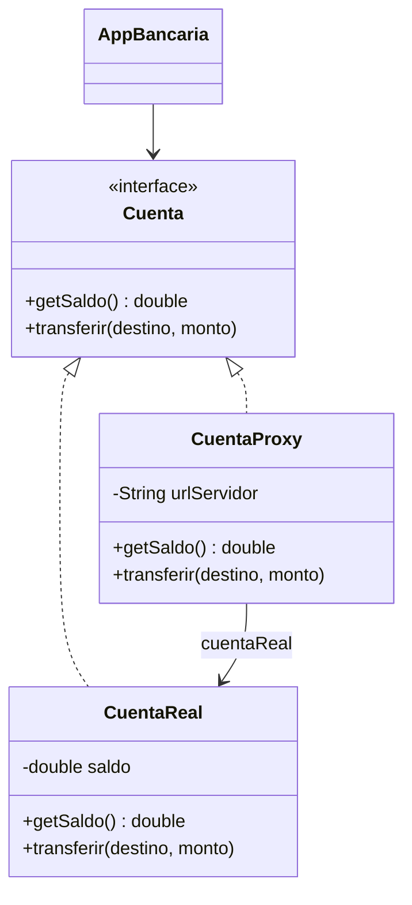

- `CuentaProxy.getSaldo()`: arma el pedido, lo manda por la red y devuelve lo que contesta `cuentaReal.getSaldo()`. `AppBancaria` no sabe que hay red de por medio: sólo conoce `Cuenta`.
- **El diagrama es el mismo para los tres tipos**; cambia lo que hace el proxy antes de delegar:
  - virtual: `ImagenProxy.mostrar()`: `if (real == null) real = new ImagenReal(archivo); real.mostrar();`
  - de protección: `SueldosProxy.consultar(u)`: `if (u.rol == RRHH) return real.consultar(u); else error;`
- refactoring.guru: `CachedYouTubeClass`, un proxy que guarda en caché las respuestas de la biblioteca de YouTube.

### Ejemplo State: máquina expendedora

| Rol | Clase |
|---|---|
| Context | `MaquinaExpendedora`: el objeto que "puede estar" en distintos estados |
| State | `EstadoMaquina` |
| ConcreteState | `SinCredito`, `ConCredito`, `SinStock`: un `case` del `switch` cada uno |

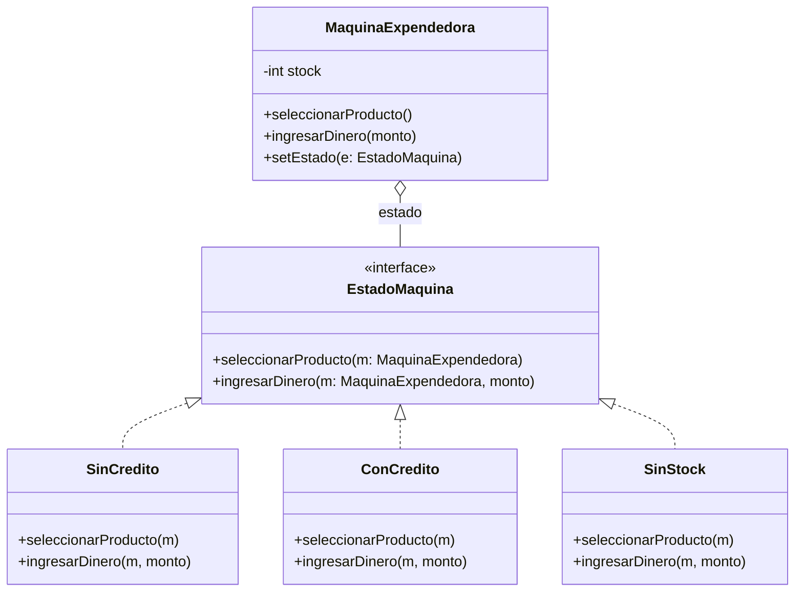

- `MaquinaExpendedora.seleccionarProducto()`: `estado.seleccionarProducto(this);`. No queda ningún `if`.
- `SinCredito.seleccionarProducto(m)`: `mostrar("Ingrese dinero");`
- `ConCredito.seleccionarProducto(m)`: `entregar(); if (m.stock == 0) m.setEstado(new SinStock()); else m.setEstado(new SinCredito());`. **Los estados hacen las transiciones.**
- `SinStock.seleccionarProducto(m)`: `devolverDinero();`

Las transiciones (diagrama de estados, aparte del de clases):

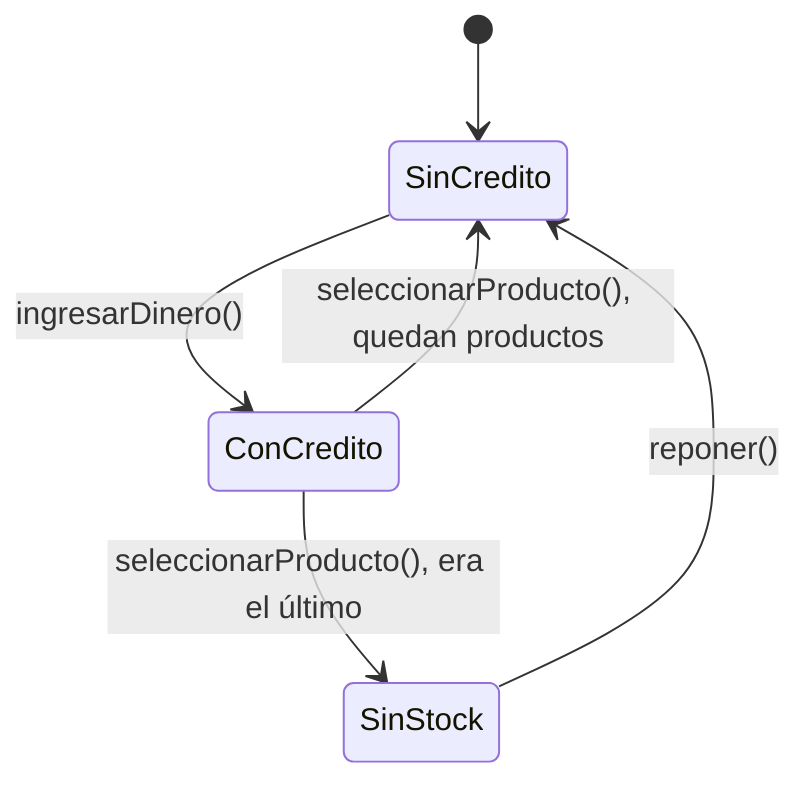

- refactoring.guru: un `Documento` que pasa por `Borrador`, `Moderacion` y `Publicado`, y `publicar()` hace algo distinto en cada uno.

### Ejemplo Observer: agenda médica

| Rol | Clase |
|---|---|
| Subject | `Sujeto` (abstracta: la lista de observadores y `notificar()`) |
| ConcreteSubject | `Agenda`: **lo que cambia** (se cancela) |
| Observer | `ObservadorAgenda` |
| ConcreteObserver | `NotificadorMail`, `TableroRecepcion`, `Auditoria`: **todos los que reaccionan** |

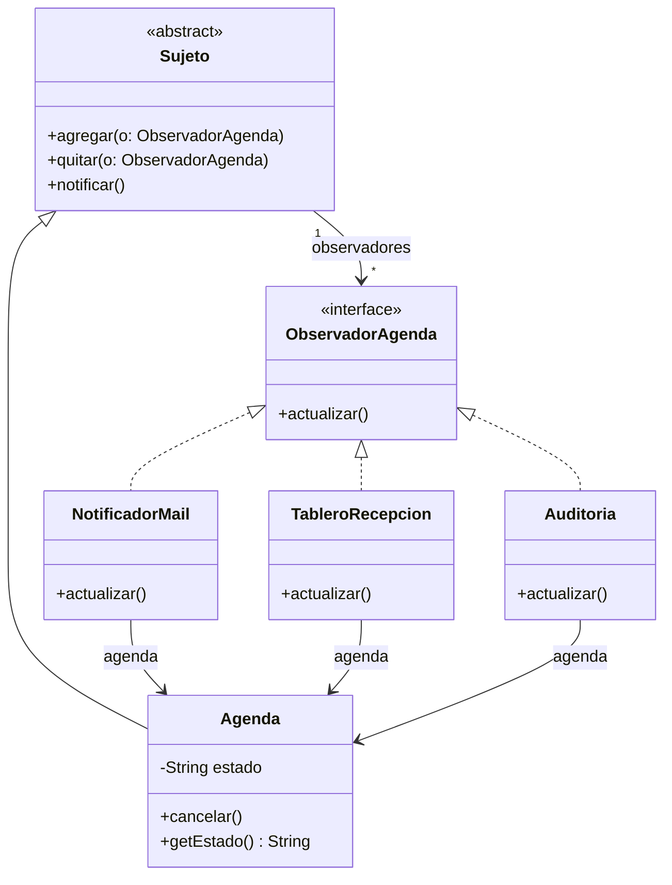

- `Agenda.cancelar()`: `estado = "CANCELADA"; notificar();`
- `Sujeto.notificar()`: `foreach o in observadores: o.actualizar();`
- `NotificadorMail.actualizar()`: `if (agenda.getEstado() == "CANCELADA") mandar un mail a cada paciente con turno;`
- Al arrancar: `agenda.agregar(new NotificadorMail(agenda)); agenda.agregar(new Auditoria(agenda));`…
- Para sumar WhatsApp: `NotificadorWhatsApp` + `agenda.agregar(...)`. **`Agenda` no se modifica.**
- refactoring.guru: un `Editor` con un `EventManager` al que se suscriben `EmailAlertsListener` y `LoggingListener`.

### Ejemplo Iterator: catálogo de la biblioteca

| Rol | Clase |
|---|---|
| Aggregate | `Catalogo` |
| ConcreteAggregate | `CatalogoArbol` (por dentro, un árbol balanceado) |
| Iterator | `IteradorLibros` |
| ConcreteIterator | `IteradorEnOrden`, `IteradorInverso`: uno por recorrido |
| Client | `ModuloListados` |

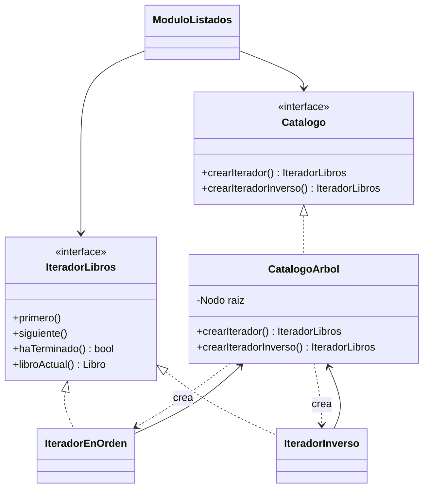

- `CatalogoArbol.crearIterador()`: `return new IteradorEnOrden(this);`
- El cliente recorre siempre igual, sin saber que hay un árbol:
  `it = catalogo.crearIterador(); it.primero(); while (!it.haTerminado()) { mostrar(it.libroActual()); it.siguiente(); }`
- Si mañana el catálogo pasa a ser una lista, se agrega `CatalogoLista` con su iterador y **`ModuloListados` no cambia** (iteración polimórfica).
- refactoring.guru: una red social que da iteradores distintos para recorrer "amigos" y "compañeros de trabajo" de un perfil.

### Pares que se confunden

*(tutor)*

| Par | Cómo distinguirlos |
|---|---|
| Factory Method vs. Abstract Factory | **Un** producto, lo decide una **subclase** del creador (herencia) vs. una **familia** de productos, el cliente recibe un **objeto fábrica** (composición) |
| Facade vs. Proxy | Interfaz **nueva y simple** para **muchas** clases vs. **misma** interfaz que **un** objeto, para controlar el acceso |
| State vs. Observer | El objeto cambia **su propio** comportamiento vs. el objeto **avisa a otros** que cambió |
| Composite vs. Iterator | Composite **arma** la estructura de árbol; Iterator la **recorre**. Se usan juntos |
| Singleton vs. Facade | Singleton controla **cuántas** instancias hay; Facade **simplifica** el acceso. Una fachada suele ser Singleton |

## Dónde me equivoco

Elegir el patrón me sale (9/9 el 2026-10-21). Me cuesta **asignar los roles**:

- **Composite** (2026-10-21): dije "empleados = hojas, departamentos = componentes, empresa = composite". **Component** es la abstracción común (`UnidadOrganizacional`), no un nivel del árbol; **Composite** es `Area`, y la empresa es una instancia más de `Area`. Tres clases, no tres niveles. [→ Ejemplo](#Ejemplo%20Composite:%20organigrama)
- **Observer** (2026-10-21): puse de Subject al turno y de Observers sólo a los pacientes. El **Subject es lo que cambia** (`Agenda`) y los **Observers son todos los que reaccionan** (mail, tablero, auditoría). [→ Ejemplo](#Ejemplo%20Observer:%20agenda%20médica)
- **State** (2026-10-21): no supe quién era el Context. Es **el objeto que "puede estar"** en distintos estados (`MaquinaExpendedora`) y delega en su estado actual. [→ Ejemplo](#Ejemplo%20State:%20máquina%20expendedora)
- Respondo el patrón sin la **frase del enunciado** que lo justifica ni el tipo (Proxy remoto). En el parcial: patrón + señal + roles.

## Ver también

- [Patrones creacionales](patrones-creacionales.md), [estructurales](patrones-estructurales.md) y [de comportamiento](patrones-de-comportamiento.md): la teoría completa de GoF.
- [Patrones GRASP](patrones-grasp.md): Indirección, Polimorfismo y Variaciones protegidas son la idea detrás de varios de estos.
- [Principios SOLID](principios-solid.md): abierto/cerrado e inversión de dependencias explican por qué el cliente apunta siempre a la abstracción.
